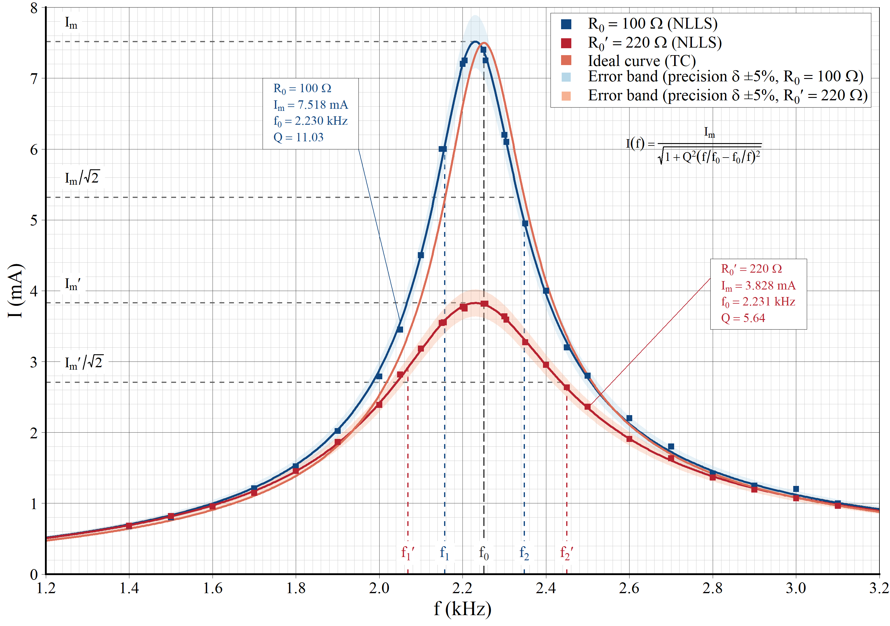

# RLC 串联电路 I–f 谐振曲线

大学物理实验 · RLC 串联电路谐振特性（电流–频率曲线）。



## 仓库内容

| 文件 | 说明 |
|---|---|
| `RLC_curve_plot.R` | 读取测量数据，计算回路电流 I，拟合谐振曲线并绘图 |
| `figures/RLC_resonance_I_f.png` | I–f 谐振曲线成品图（2952×2078） |

同一脚本还会输出一幅 `U_C / U_L / U_R – f` 幅频特性图，本仓库只收录了 I–f 谐振曲线。

## 实验参数

| 参数 | 数值 |
|---|---|
| 电感 L | 0.100 H |
| 电容 C | 0.0500 μF |
| 取样电阻 R₁ | 100 Ω |
| 取样电阻 R₂ | 220 Ω |
| 激励电压 U | 0.900 V |

## 处理方法

- 由取样电阻电压换算回路电流：`I = U_R / R`；
- 用谐振公式做非线性最小二乘拟合：

  $$I(f)=\frac{I_m}{\sqrt{1+Q^2\left(\frac{f}{f_0}-\frac{f_0}{f}\right)^2}}$$

  得到谐振频率 `f₀`、品质因数 `Q` 与峰值电流 `I_m`；
- 两根曲线分别对应 R₁ = 100 Ω 与 R₂ = 220 Ω，用于对比不同回路电阻下的谐振锐度。

## 运行方法

```r
# 1. 安装依赖
install.packages(c("readxl", "ggplot2"))

# 2. 将原始数据表放到脚本同目录
#    表3-19-1-测量I-f谐振曲线数据表(3).xlsx

# 3. 运行
source("RLC_curve_plot.R")   # 或在 RStudio 中打开后 Source
```

脚本会把图输出到当前工作目录。原始数据表为课程实验数据，**未包含在本仓库中**；如需完整复现，请把该 xlsx 放到脚本同目录。

## 注意

- 脚本使用 Windows 字体 Times New Roman，建议在 Windows + RStudio 下运行；
- 非线性拟合的初值写在 `fit_res()` 的 `start` 参数里，更换数据后若拟合不收敛，需要相应调整初值。
